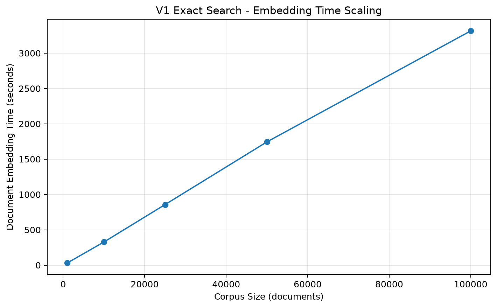
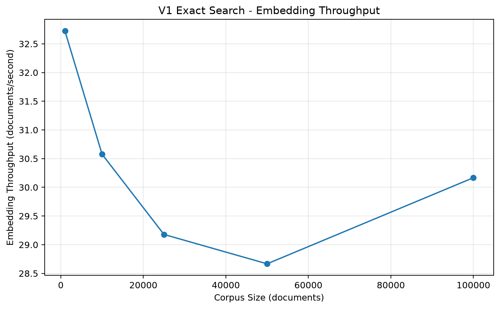
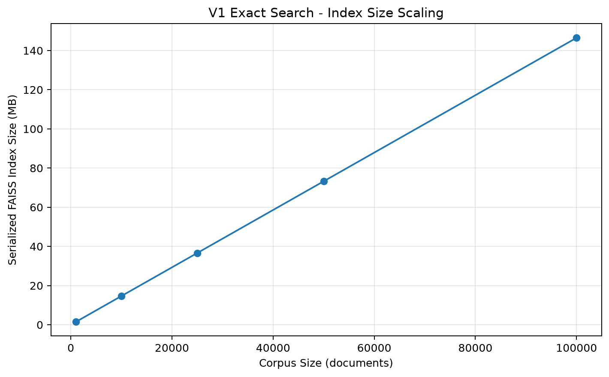
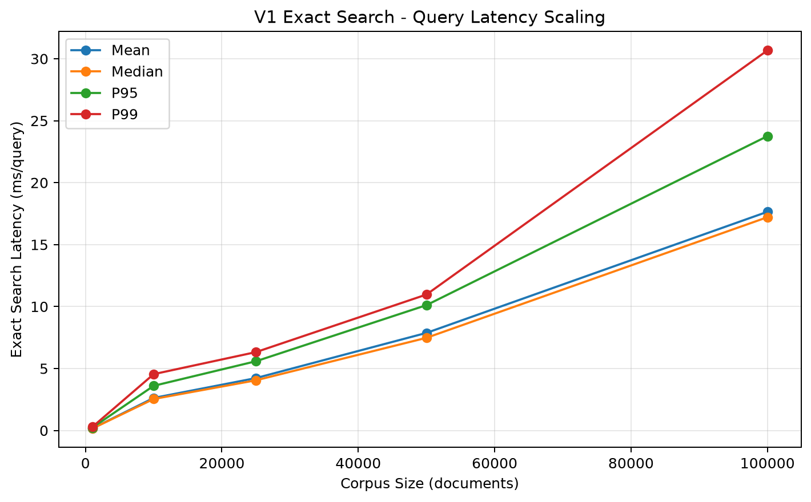
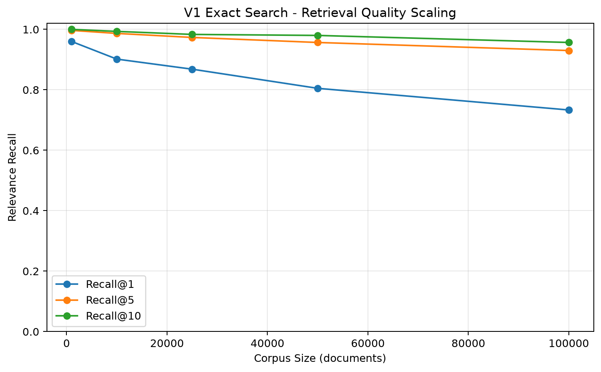
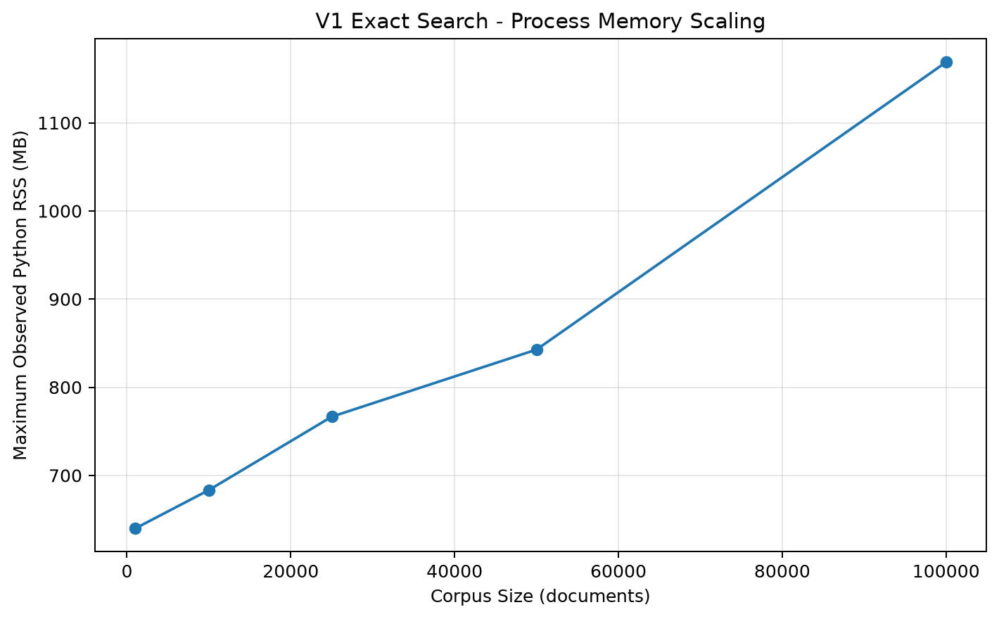

# Big Data Vector Search

**Scalable Semantic Search and Approximate Nearest Neighbor Systems**

A research-oriented project investigating the **performance, scalability, retrieval quality, memory consumption, and system design of vector search over increasingly large embedding collections**.

The project progresses from an exact semantic-search baseline toward **Approximate Nearest Neighbor (ANN) indexing, large-scale vector collections, distributed embedding and index construction, cloud-based vector search, and multi-objective system optimization**.

The central systems tradeoff is:

\[
\boxed{
\text{Recall}
\leftrightarrow
\text{Latency}
\leftrightarrow
\text{Memory}
\leftrightarrow
\text{Index Build Cost}
}
\]

---

## Project Status

| Version | Focus | Status |
|---|---|---|
| **V1** | Exact Vector Search Baseline | ✅ Complete |
| **V2** | Approximate Nearest Neighbor Indexes | ⏳ Next |
| **V3** | Large-Scale Vector Search | Planned |
| **V4** | Index Parameter Optimization | Planned |
| **V5** | Distributed Embedding & Index Construction | Planned |
| **V6** | Cloud / Distributed Vector Search | Planned |
| **V7** | Multi-Objective Vector Search Optimization | Planned |

---

# V1 — Exact Vector Search Baseline

**Status: COMPLETE**

V1 establishes a controlled exact-search baseline using:

- **MS MARCO**
- **300 fixed evaluation queries**
- **Sentence Transformers**
- **all-MiniLM-L6-v2**
- **384-dimensional embeddings**
- **L2 normalization**
- **FAISS IndexFlatIP**
- **exact Top-K nearest-neighbor search**

The benchmark scales from:

```text
1K → 10K → 25K → 50K → 100K documents
```

while keeping the evaluation workload fixed.

---

## V1 Architecture

```text
MS MARCO
    ↓
Controlled Nested Corpora
    ↓
Sentence Transformer
    ↓
Normalized 384-D Embeddings
    ↓
FAISS IndexFlatIP
    ↓
300 Fixed Query Embeddings
    ↓
Exact Top-K Search
    ↓
Recall + Latency + Memory + Storage
    ↓
Validated Exact Neighbor Ground Truth
```

---

# V1 Research Question

The primary V1 research question is:

> **How does exact semantic vector search behave as the indexed vector collection grows from 1K to 100K documents?**

V1 measures:

- document embedding time;
- embedding throughput;
- exact index construction time;
- serialized index size;
- query embedding time;
- mean search latency;
- median search latency;
- P95 and P99 search latency;
- Recall@1;
- Recall@5;
- Recall@10;
- Hit Rate@K;
- Python process memory.

---

# Controlled MS MARCO Benchmark

V1 uses the MS MARCO collection distributed through the BEIR dataset ecosystem.

The source corpus contains approximately **8.84 million documents/passages**.

A controlled nested benchmark is generated:

\[
S_{1K}
\subset
S_{10K}
\subset
S_{25K}
\subset
S_{50K}
\subset
S_{100K}
\]

The benchmark uses:

```text
Evaluation queries:          300
Random seed:                 42
Eligible validation queries: 6,980
Positive qrel pairs:         314
Required relevant documents: 314
```

Every corpus size contains all 314 required relevant documents.

The 1K baseline therefore contains:

```text
314 relevant documents
686 deterministic distractors
```

Additional corpus sizes introduce more distractor documents while preserving the same evaluation queries and relevant-document set.

---

# Embedding Model

V1 uses:

```text
sentence-transformers/all-MiniLM-L6-v2
```

with:

```text
Embedding dimension: 384
Batch size:          64
Normalization:       L2
```

Because vectors are L2 normalized, inner-product ranking corresponds to cosine-similarity ranking.

---

# Exact Vector Index

The V1 index is:

```text
FAISS IndexFlatIP
```

`IndexFlatIP` performs exhaustive exact nearest-neighbor search.

This is important because V1 contains **no ANN approximation error**.

The exact Top-K results therefore provide the algorithmic ground truth for future ANN experiments.

---

# V1 Results

The final current-provenance experimental results are:

| Documents | Embed Time (s) | Docs/s | Index Size (MB) | Mean Search (ms) | P95 (ms) | Recall@1 | Recall@5 | Recall@10 | Max RSS (MB) |
|---:|---:|---:|---:|---:|---:|---:|---:|---:|---:|
| **1,000** | 30.56 | 32.72 | 1.46 | 0.160 | 0.226 | 0.9600 | **0.9967** | 1.0000 | 639.7 |
| **10,000** | 327.05 | 30.58 | 14.65 | 2.625 | 3.603 | 0.9017 | **0.9867** | 0.9933 | 683.4 |
| **25,000** | 856.79 | 29.18 | 36.62 | 4.227 | 5.587 | 0.8683 | **0.9733** | 0.9833 | 766.6 |
| **50,000** | 1,744.18 | 28.67 | 73.24 | 7.874 | 10.114 | 0.8050 | **0.9567** | 0.9800 | 842.7 |
| **100,000** | 3,314.86 | 30.17 | 146.48 | **17.649** | **23.755** | 0.7333 | **0.9300** | 0.9567 | 1,168.8 |

---

# V1 Scaling Summary

Scaling the collection from **1K to 100K documents** represents a:

\[
100\times
\]

increase in corpus size.

Measured scaling:

| Measurement | Growth |
|---|---:|
| Corpus size | **100.00×** |
| Embedding time | **108.47×** |
| Index size | **100.00×** |
| Mean search latency | **110.40×** |
| P95 search latency | **105.34×** |
| Python RSS | **1.83×** |

---

# Key Finding 1 — Embedding Dominates Offline Processing

Document embedding is the dominant preprocessing cost.

At 100K documents:

```text
Document embedding:   3,314.86 seconds
Index construction:   ~0.063 seconds
```

Embedding throughput remains relatively stable across corpus sizes:

```text
1K       32.72 docs/s
10K      30.58 docs/s
25K      29.18 docs/s
50K      28.67 docs/s
100K     30.17 docs/s
```

This indicates approximately linear document-embedding scaling under the tested environment.





---

# Key Finding 2 — Exact Index Storage Scales Linearly

The serialized `IndexFlatIP` index grows from:

```text
1K       1.46 MB
100K   146.48 MB
```

This is effectively a **100× storage increase for a 100× increase in vectors**.

The result is expected because `IndexFlatIP` retains the complete float32 vector representation.

For a 384-dimensional float32 vector:

\[
384 \times 4 = 1536 \text{ bytes/vector}
\]



---

# Key Finding 3 — Exact Search Latency Becomes Increasingly Expensive

Mean exact-search latency grows from:

```text
1K       0.160 ms/query
10K      2.625 ms/query
25K      4.227 ms/query
50K      7.874 ms/query
100K    17.649 ms/query
```

From 1K to 100K, mean search latency increases approximately:

\[
110.40\times
\]

P95 latency grows from:

```text
0.226 ms
```

to:

```text
23.755 ms
```

or approximately:

\[
105.34\times
\]

This growth motivates the transition from exhaustive exact search to Approximate Nearest Neighbor indexing.



---

# Key Finding 4 — Relevance Recall Declines as the Search Space Grows

Recall@5 changes from:

```text
1K       0.9967
10K      0.9867
25K      0.9733
50K      0.9567
100K     0.9300
```

Recall@1 changes from:

```text
0.9600 → 0.7333
```

and Recall@10 changes from:

```text
1.0000 → 0.9567
```

The Recall@5 change from 1K to 100K is:

\[
-0.0667
\]

Importantly, this decline occurs under **exact search**.

It is therefore **not ANN approximation error**.

Instead, the increasingly large collection introduces more semantically competitive documents that can rank above known relevant documents.



---

# Key Finding 5 — Memory and Index Size Are Different Measurements

Maximum observed Python process RSS increases from:

```text
639.7 MB
```

at 1K documents to:

```text
1,168.8 MB
```

at 100K documents.

This represents approximately:

\[
1.83\times
\]

growth.

Process RSS includes:

- Python runtime;
- PyTorch;
- Sentence Transformer model;
- document text;
- embedding arrays;
- query vectors;
- FAISS index;
- experiment data structures.

It should therefore not be interpreted as FAISS index size.

Serialized index size is measured separately.



---

# Relevance Recall vs. ANN Recall

A central methodological distinction in this project is the difference between **relevance recall** and **ANN recall**.

## Relevance Recall

Relevance Recall asks:

> Does vector search retrieve documents identified as relevant by the benchmark?

For query \(q\):

\[
Recall@K_{relevance}(q)
=
\frac{
|\text{Relevant}(q)\cap TopK(q)|
}{
|\text{Relevant}(q)|
}
\]

V1 measures this metric using MS MARCO relevance judgments.

---

## ANN Recall

Future ANN experiments will ask:

> How closely does an approximate index reproduce the exact nearest neighbors?

For query \(q\):

\[
Recall@K_{ANN}(q)
=
\frac{
|TopK_{ANN}(q)\cap TopK_{Exact}(q)|
}{
K
}
\]

These metrics answer different questions.

A vector index can reproduce exact neighbors extremely well while the embedding model itself does not rank all benchmark-relevant documents in the Top-K.

V2 will therefore report both metrics separately.

---

# Exact-Neighbor Ground Truth

For every V1 scale point, the project saves the exact Top-10 nearest neighbors for all 300 queries:

```text
results/v1_exact_neighbors_1k.jsonl
results/v1_exact_neighbors_10k.jsonl
results/v1_exact_neighbors_25k.jsonl
results/v1_exact_neighbors_50k.jsonl
results/v1_exact_neighbors_100k.jsonl
```

These files become the algorithmic ground truth for V2.

---

# Experimental Integrity

V1 uses multiple independent validation layers:

```text
Benchmark Preparation
        ↓
Independent Benchmark Validation
        ↓
Exact Search
        ↓
SHA-256 Provenance
        ↓
Exact-Neighbor Validation
        ↓
Provenance-Aware Scaling Analysis
```

This separation reduces the risk of mixing incompatible experimental artifacts.

---

# SHA-256 Benchmark Provenance

Each exact-search experiment records SHA-256 fingerprints for:

```text
corpus.jsonl
queries.jsonl
qrels.json
benchmark_manifest.json
```

The exact-neighbor validator independently recomputes these fingerprints.

If the benchmark changes:

```text
Experiment hash ≠ Current benchmark hash
```

the artifact is rejected.

This protection was deliberately tested by corrupting a copied fingerprint. The validator correctly rejected the modified experiment record with a nonzero exit status.

---

# V1 Validation

The benchmark validator verifies:

- 300 unique queries;
- positive qrels;
- expected corpus sizes;
- unique document IDs;
- all required relevant documents present;
- nested corpus subsets;
- benchmark-manifest consistency.

The exact-neighbor validator verifies:

- complete query set;
- exactly 10 neighbors per query;
- rank sequence 1–10;
- unique neighbors;
- corpus membership;
- finite similarity scores;
- non-increasing similarity scores;
- qrels metadata consistency;
- SHA-256 provenance.

All final V1 artifacts pass validation.

---

# Provenance-Aware Analysis

The cumulative experiment log contained six successful records because an early 1K experiment was performed before the final benchmark manifest was created.

The V1 analyzer calculated the current manifest SHA-256 and automatically selected only experiments belonging to the current benchmark:

```text
CSV rows:                   6
Successful rows:            6
Current-provenance rows:    5
Obsolete successful rows:   1
Selected scale runs:        5
```

This prevents historical experiments from silently contaminating the final scaling analysis.

---

# V1 Analysis Artifacts

Summary:

```text
results/v1_scaling_summary.csv
```

Figures:

```text
results/v1_embedding_time.png
results/v1_embedding_throughput.png
results/v1_index_size.png
results/v1_search_latency.png
results/v1_memory.png
results/v1_recall.png
```

Detailed methodology and results:

**[V1 Exact Search Results](docs/v1-exact-search-results.md)**

---

# V1 Programs

Benchmark preparation:

```text
src/prepare_msmarco_benchmark.py
```

Independent benchmark validation:

```text
src/validate_v1_benchmark.py
```

Exact-search experiment:

```text
src/evaluate_exact_search.py
```

Exact-neighbor validation:

```text
src/validate_exact_neighbors.py
```

Scaling analysis:

```text
src/analyze_v1_scaling.py
```

---

# V2 — Approximate Nearest Neighbor Search

**Status: NEXT**

V2 will introduce Approximate Nearest Neighbor indexes and compare them against the V1 exact ground truth.

Planned index architectures include:

```text
IndexFlatIP
    ↓
HNSW
    ↓
IVF
    ↓
IVF-PQ
```

The primary V2 question is:

> **How much search latency and memory can be reduced before ANN recall degrades significantly?**

---

# V2 Evaluation

For each ANN configuration, V2 will measure:

```text
ANN Recall@K
Relevance Recall@K
Mean Search Latency
Median Search Latency
P95 / P99 Latency
Index Build Time
Index Size
Memory
```

The central tradeoff becomes:

\[
\boxed{
ANN\ Recall
\leftrightarrow
Search\ Latency
\leftrightarrow
Memory
}
\]

The V1 exact-neighbor files provide the ground truth required to quantify ANN approximation error.

---

# Future Roadmap

## V3 — Large-Scale Vector Search

Extend experiments toward:

```text
250K
500K
1M+
```

vectors.

Investigate when exact search becomes operationally impractical and how ANN architectures behave at larger scale.

---

## V4 — Index Parameter Optimization

Systematically study parameters such as:

```text
HNSW
  M
  efConstruction
  efSearch

IVF
  nlist
  nprobe

IVF-PQ
  nlist
  nprobe
  m
  nbits
```

and quantify their effects on recall, latency, memory, and build cost.

---

## V5 — Distributed Embedding & Index Construction

Investigate distributed preprocessing using:

- Apache Spark;
- PySpark;
- distributed storage;
- parallel embedding;
- distributed vector-data preparation.

---

## V6 — Cloud / Distributed Vector Search

Evaluate genuine cloud and distributed deployments.

Potential environments include:

- Google Cloud;
- Dataproc;
- Databricks;
- AWS;
- Azure.

Research questions include scalability, distributed throughput, resource requirements, and cloud cost.

---

## V7 — Multi-Objective Vector Search Optimization

Investigate automatic vector-index configuration.

Potential objectives include:

\[
\max Recall(x)
\]

while minimizing:

\[
Latency(x)
\]

\[
Memory(x)
\]

\[
BuildTime(x)
\]

and:

\[
Cost(x)
\]

Possible approaches include:

- grid search;
- Bayesian optimization;
- evolutionary algorithms;
- multi-objective optimization.

---

# Relationship to Scalable RAG

This project is related to, but intentionally distinct from:

**[Scalable RAG with Apache Spark](https://github.com/BigDataAISystems/scalable-rag-spark)**

The Scalable RAG project investigates:

```text
retrieval
+
evidence quality
+
generation
+
RAG evaluation
+
distributed embedding
```

Big Data Vector Search focuses specifically on:

```text
embedding collections
+
vector indexes
+
nearest-neighbor algorithms
+
search latency
+
memory
+
recall
+
scalability
```

The projects therefore share some infrastructure and research themes while addressing different systems questions.

---

# Repository Structure

```text
big-data-vector-search/
│
├── README.md
├── requirements.txt
├── .gitignore
│
├── docs/
│   ├── v1-exact-search-baseline.md
│   └── v1-exact-search-results.md
│
├── src/
│   ├── prepare_msmarco_benchmark.py
│   ├── validate_v1_benchmark.py
│   ├── evaluate_exact_search.py
│   ├── validate_exact_neighbors.py
│   └── analyze_v1_scaling.py
│
├── results/
│   ├── v1_exact_*.json
│   ├── v1_exact_neighbors_*.jsonl
│   ├── v1_exact_search_experiments.csv
│   ├── v1_scaling_summary.csv
│   └── v1_*.png
│
└── data/
    └── generated benchmark data
```

Large generated benchmark corpora, embeddings, and indexes are excluded from Git and can be regenerated using the provided scripts.

---

# Installation

Clone the repository:

```bash
git clone https://github.com/BigDataAISystems/big-data-vector-search.git
cd big-data-vector-search
```

Create a Python virtual environment.

Windows PowerShell:

```powershell
python -m venv .venv
.\.venv\Scripts\Activate.ps1
```

Install dependencies:

```powershell
python -m pip install --upgrade pip
python -m pip install -r requirements.txt
```

---

# Core Technologies

The project currently uses:

- Python
- Sentence Transformers
- FAISS
- NumPy
- Pandas
- Hugging Face Datasets
- Matplotlib
- psutil

Future versions will introduce additional ANN, distributed-computing, cloud, and vector-database technologies.

---

# Experimental Principles

The project follows several principles intended to improve experimental reproducibility.

### Controlled Variables

Hold the evaluation workload and system configuration constant while changing the primary experimental factor.

### Deterministic Sampling

Use explicit random seeds for benchmark generation.

### Exact Baselines

Evaluate ANN algorithms against exact nearest-neighbor ground truth.

### Separate Measurements

Measure embedding, index construction, query embedding, and vector search independently.

### Machine-Readable Results

Store raw experiment measurements in structured formats such as JSON, JSONL, and CSV.

### Provenance

Record cryptographic fingerprints of benchmark artifacts.

### Independent Validation

Validate generated benchmarks and exact-neighbor artifacts independently from the programs that create them.

### Historical Experiment Isolation

Do not mix results from incompatible benchmark versions.

---

# V1 Conclusion

V1 establishes the exact-search reference for the project.

Scaling from 1K to 100K documents produced:

```text
Corpus size                 100.00×
Embedding time              108.47×
Index size                  100.00×
Mean search latency         110.40×
P95 search latency          105.34×
Python RSS                    1.83×
```

At the same time:

```text
Recall@1     0.9600 → 0.7333
Recall@5     0.9967 → 0.9300
Recall@10    1.0000 → 0.9567
```

The experiments show that exact vector search provides strong retrieval quality but increasingly expensive search as the vector collection grows.

V1 also establishes validated exact Top-K ground truth, enabling V2 to measure ANN approximation independently from semantic retrieval quality.

---

# Organization

This project is developed under:

**[Big Data & AI Systems](https://github.com/BigDataAISystems)**

The organization focuses on research and open-source projects at the intersection of:

- Big Data;
- distributed systems;
- cloud computing;
- scalable AI;
- AI-powered data systems.

---

# Author

**Mahdi Ebrahimi, Ph.D.**
Associate Professor of Computer Science
California State University, Northridge

Research interests include:

- Big Data & AI Systems
- distributed data processing
- cloud computing
- scalable AI/ML systems
- vector search
- information retrieval
- optimization
- AI-powered data systems

---

## Current Milestone

**V1 — Exact Vector Search Baseline: COMPLETE**

**Next: V2 — Approximate Nearest Neighbor Search**
